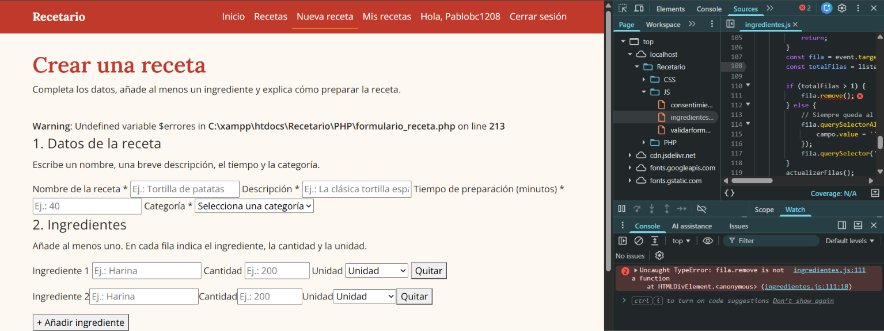
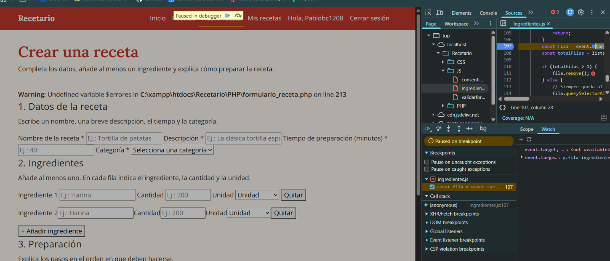
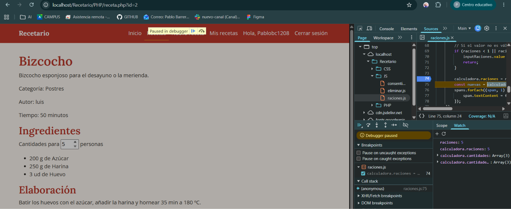
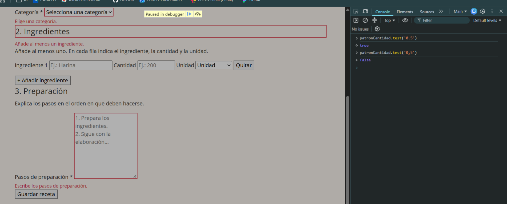
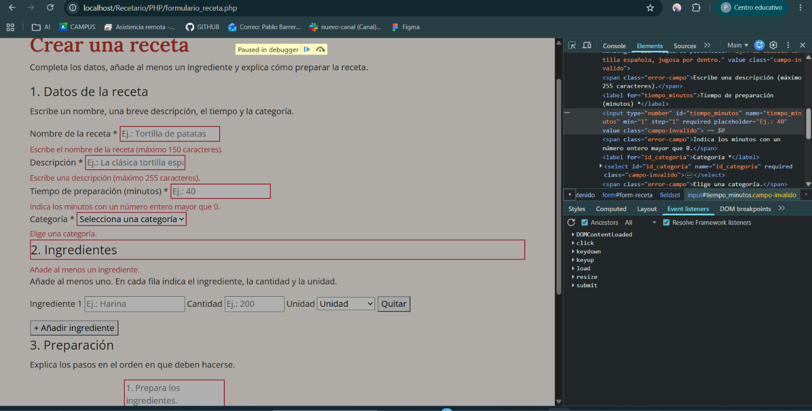
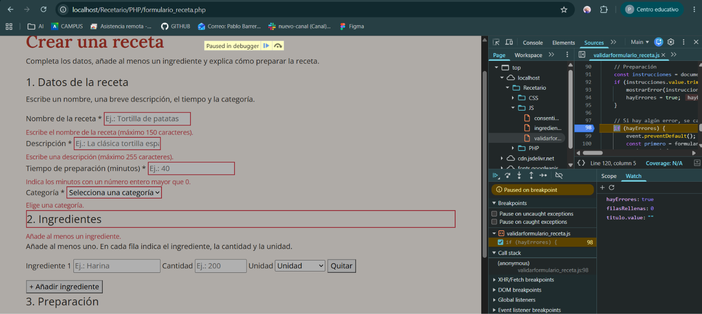

# Depuración del JavaScript con las DevTools

Cómo hemos depurado los scripts de `JS/` con las herramientas de desarrollo del navegador (Chrome: `F12` o clic derecho → *Inspeccionar*). Las capturas están en [`docs/depuracionJS/`](depuracionJS/) y cada prueba está anotada en el [registro de pruebas](registro-pruebas.md).

## Herramientas usadas

| Pestaña | Para qué la usamos |
|---|---|
| **Console** | Ver errores de JS con el archivo y la línea, y probar variables y funciones escribiéndolas a mano. |
| **Sources** | Poner puntos de ruptura (*breakpoints*), ejecutar paso a paso y ver el valor de las variables en *Scope*. |
| **Elements** (inspector) | Ver cómo cambia el HTML y las clases CSS cuando el JS añade o quita elementos. |
| **Application** | Ver las cookies que guarda la página (`vista_listado`, `cc_cookie`). |

## Sesión 1. Error real en el botón «Quitar» ingrediente (`JS/ingredientes.js`)

**Problema.** En *Nueva receta*, al pulsar «Quitar» en una fila de ingredientes no pasaba nada.

1. **Console.** Al pulsar «Quitar» sale en rojo:
   `Uncaught TypeError: fila.remove is not a function` en `ingredientes.js:111`.
   Al hacer clic en el enlace del error se abre la línea en *Sources*.
2. **Sources → punto de ruptura** en la línea 107 (`const fila = ...`). Se vuelve a pulsar «Quitar», la ejecución se para y con *Step over* (`F10`) se avanza una línea.
3. En el panel **Watch** se añade `event.target.parentNode`, que es el `<p class="fila-ingrediente">`: eso es lo que debería guardarse en `fila`. Pero la línea era:
   ```js
   const fila = event.target.classList.contains('btn-quitar');
   ```
   `classList.contains()` devuelve un booleano, y un booleano no tiene el método `remove()`. El fallo entró al cambiar `matches` por `classList` (#17): se cambió la línea que no era.
4. **Solución.** `classList.contains` va en la comprobación del botón, y la fila es el padre del botón:
   ```js
   if (!event.target.classList.contains('btn-quitar')) {
       return;
   }
   const fila = event.target.parentNode;
   ```
5. **Elements.** Con el inspector abierto sobre `#lista-ingredientes` se comprueba que al pulsar «Quitar» desaparece el `<p class="fila-ingrediente">`, y que con una sola fila los campos se vacían en vez de borrarse.

Capturas: `depuracion_ingredientes.png` (error en consola) y `depuracion_ingredientes_breakpoint.png` (parado en la línea 107 con `event.target.parentNode` en *Watch*).

En las dos capturas también se ve el aviso de PHP `Undefined variable $errores` (línea 213 de `formulario_receta.php`). Es otro fallo que salió al probar: faltaba `$errores = [];` al principio del archivo y se ha añadido en esta misma issue.




## Sesión 2. Calculadora de raciones (`JS/raciones.js`)

1. **Sources → punto de ruptura** dentro del `addEventListener('change', ...)`, en `calculadora.raciones = raciones;`.
2. En la receta se cambia «Cantidades para» de 4 a 5. La ejecución se para y en **Watch** se ve `raciones: 5`; con *Step over* (`F10`) `calculadora.raciones` también pasa a 5.
3. En **Watch** se despliega `calculadora.cantidadesNuevas()` y se comprueba que cada cantidad sale multiplicada por 5/4 (200 → 250).
4. Se prueba un valor fuera de rango (25): la ejecución no llega a la línea 74 porque el `return` del `if` corta antes, y el campo vuelve al valor anterior.

Captura: `depuracion_raciones.png`.



## Sesión 3. Validación del formulario (`JS/validarformulario_receta.js`)

1. Se envía el formulario vacío. **Elements:** aparecen los `<span class="error-campo">` y los campos llevan la clase `campo-invalido`; en *Network* no sale ninguna petición porque `preventDefault()` cancela el envío.
2. **Console:** se prueban los patrones a mano, por ejemplo `patronCantidad.test('0.5')` → `true` y `patronCantidad.test('0,5')` → `false`.
3. **Sources:** punto de ruptura en `if (hayErrores) {` para ver qué valor tiene `hayErrores` y `filasRellenas` antes de decidir si se envía.

Capturas: `depuracion-validacion1.png`, `depuracion-validacion2.png` y `depuracion-validacion3.png`.





## Sesión 4. Cookie de la vista del listado (`JS/cookies.js`)

1. En el listado se aceptan las cookies y se pulsa «Lista».
2. **Application → Cookies:** aparece `vista_listado = lista` con caducidad el 31 de diciembre del año que viene.
3. **Console:** `leerCookie('vista_listado')` devuelve `"lista"` y `hayPermisoPreferencias()` devuelve `true`. Si se rechazan las cookies de preferencias, la cookie se borra y la función devuelve `false`.

## Conclusiones

- Leer el error de la consola da el archivo y la línea exactos, así que es lo primero que se mira.
- Un punto de ruptura y el panel *Watch* enseñan el valor real de cada variable; así encontramos el fallo de `ingredientes.js`, que a simple vista parecía correcto.
- El inspector sirve para comprobar que el JS cambia bien el HTML y las clases.
