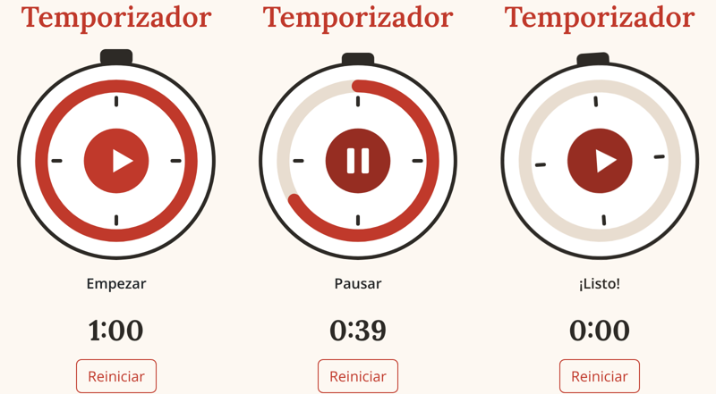

# Temporizador de cocina en SVG

He hecho un temporizador de cocina que aparece en la página de cada receta, al lado de la receta. Cuenta atrás los minutos que tarda en hacerse.

## Cómo funciona

- Si pulsas el dibujo empieza la cuenta atrás. El anillo rojo se va vaciando y el icono cambia de ▶ a ❚❚.
- Si lo vuelves a pulsar se pausa, y con otro clic sigue.
- Al llegar a 0:00 pone «¡Listo!» y el dibujo vibra.
- «Reiniciar» vuelve al tiempo de la receta.

## Herramienta: Figma

He usado Figma. He dibujado el temporizador con formas básicas (círculos, rectángulos y un triángulo), cada una con su nombre de capa, y lo he exportado como SVG. El icono de pausa lo he dibujado en otro frame.

## Análisis del código que genera

| Problema                                                                          | Qué he hecho                                                                      |
| --------------------------------------------------------------------------------- | ---------------------------------------------------------------------------------- |
| `width` y `height` fijos (240 px), así que no es responsive                  | Los he quitado. Dejo solo el `viewBox` y el tamaño lo pone el CSS               |
| Colores escritos dentro del SVG (`fill="#C0392B"`)                              | Los he pasado al CSS con las variables de la guía de estilo                       |
| Usa los nombres de capa como `id`, y `boton` se repite en los dos archivos    | Los he cambiado por clases. Solo el anillo lleva `id`, porque lo usa el JS       |
| Cosas que sobran: un `<g>` que lo envuelve todo, un `clipPath` y el `xmlns` | Las he quitado                                                                     |
| Play y pausa están en dos SVG distintos                                          | He puesto los dos iconos en el mismo SVG y el CSS enseña uno u otro con una clase |
| El anillo empieza a dibujarse por la derecha                                      | Lo he girado -90° con `transform="rotate(-90 120 124)"` para que empiece arriba |
| No tiene nada de accesibilidad                                                    | El SVG va dentro de un `<button>` con texto y lleva `aria-hidden="true"`       |

## Cómo está integrado

He metido el SVG en línea en `PHP/receta.php` para poder cambiarlo con CSS y JS. En escritorio va en una columna a la derecha (`col-md-8` para la receta y `col-md-4` para el temporizador) y en móvil queda debajo de la elaboración.

- **HTML** (`PHP/receta.php`): el SVG, el botón y un campo oculto con los minutos de la receta.
- **CSS** (`CSS/style.css`, sección 9): colores, cambio de icono, `:hover`, `transition` del anillo y `@keyframes vibrar`.
- **JS** (`JS/temporizador.js`): la cuenta atrás con `setInterval`, que actualiza el tiempo y pone y quita las clases.

El anillo se vacía con `stroke-dasharray` y `stroke-dashoffset`. El trazo mide lo mismo que la circunferencia  y cada segundo el JS aumenta `stroke-dashoffset`: 0 es el anillo lleno y 521,5 el anillo vacío.
